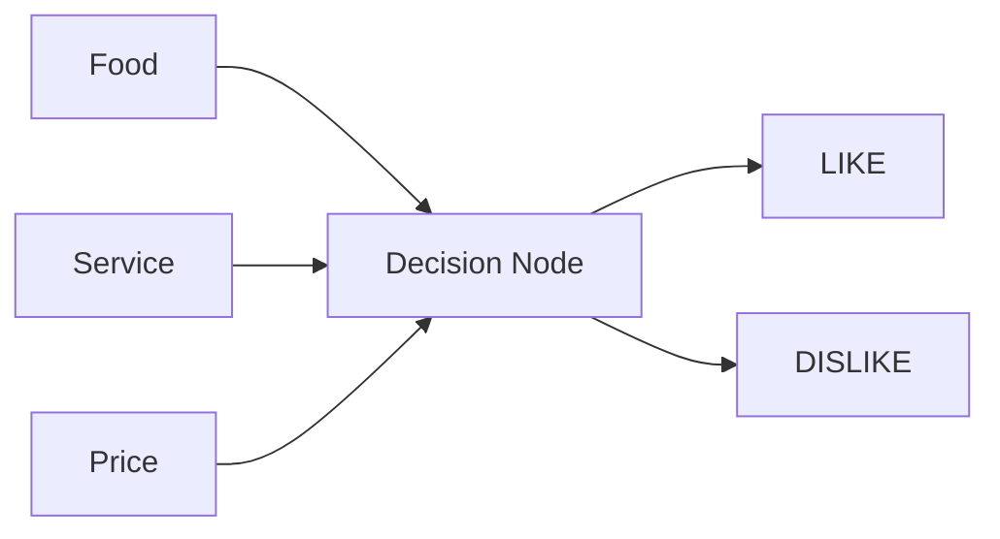

# Neural Network Simulation Lab: Restaurant Reviews

## Step 1: Draw Your Neural Network

This simple neural network uses three inputs, one decision node, and two possible outputs.

- **Input layer:** Food, Service, Price
- **Middle layer:** One decision node
- **Output layer:** LIKE or DISLIKE

## Part A: Training Phase

### Step 2: Assign Roles

- **Input Feeder:** Reads each restaurant scenario.
- **Decision Node:** Predicts whether the customer will LIKE or DISLIKE the restaurant.
- **Observers/Trackers:** Record predictions, reveal the correct answers, and discuss weight adjustments.

### Step 3: Process the 10 Training Scenarios

The table below shows one example set of predictions based on the patterns in the supplied scenarios.

| Card | Food | Service | Price | Prediction | Correct answer | Result |
|---:|---|---|---|---|---|---|
| 1 | Great | Poor | Cheap | LIKE | LIKE | Correct |
| 2 | Bad | Great | Expensive | DISLIKE | DISLIKE | Correct |
| 3 | Good | Okay | Moderate | LIKE | LIKE | Correct |
| 4 | Poor | Poor | Cheap | DISLIKE | DISLIKE | Correct |
| 5 | Excellent | Excellent | Expensive | LIKE | LIKE | Correct |
| 6 | Okay | Bad | Moderate | DISLIKE | DISLIKE | Correct |
| 7 | Great | Okay | Cheap | LIKE | LIKE | Correct |
| 8 | Poor | Excellent | Expensive | DISLIKE | DISLIKE | Correct |
| 9 | Excellent | Poor | Moderate | LIKE | LIKE | Correct |
| 10 | Okay | Okay | Expensive | DISLIKE | DISLIKE | Correct |

**Example training score: 10/10 (100%).**

> Note: These are illustrative predictions, not results recorded from an actual classroom activity. Since this example has no incorrect predictions, it does not demonstrate a real weight adjustment. During the classroom simulation, record the group's actual guesses and change tokens when a guess is wrong.

### Understanding and Assigning Weights

A weight represents how much influence an input has on the decision. More tokens mean a feature has more influence.

**Example final weight tracker:**

| Feature | Tokens | Weight |
|---|---:|---:|
| Food | 🍗 🍗 🍗 | 3 |
| Service | 🍽️ 🍽️ | 2 |
| Price | 💰 💰 | 2 |

**Why these weights?**

- **Food (3):** Food quality appears to be the strongest pattern in the examples.
- **Service (2):** Service can influence the customer's experience.
- **Price (2):** Price can affect whether a customer feels the restaurant is worth the cost.

**How weight adjustment works:**

1. Make a prediction using the current weights.
2. Reveal the correct answer.
3. If the prediction is wrong, discuss which feature may have been given too little or too much importance.
4. Add a token to a feature that should have had more influence, or remove a token from a feature that misled the decision.
5. Record the new weights and continue.

## Part B: Testing Phase

### Step 4: Test the 3 New Scenarios

Use the weights learned during training to predict the test cards.

| Card | Food | Service | Price | Prediction | Correct answer | Result |
|---:|---|---|---|---|---|---|
| 11 | Good | Excellent | Cheap | LIKE | LIKE | Correct |
| 12 | Bad | Bad | Expensive | DISLIKE | DISLIKE | Correct |
| 13 | Excellent | Great | Moderate | LIKE | LIKE | Correct |

**Example testing score: 3/3 (100%).**

> These are illustrative predictions based on the supplied answer labels. Replace them with your team's actual predictions if your instructor requires results from the live activity.

### Step 5: Team Comparison

- Compare each team's training and testing scores.
- Discuss which features seemed most important.
- Explain whether the weights changed during training and why.

## Reflection Questions

### 1. How did your predictions improve?

My predictions improved because I looked for patterns in the training examples and learned which features were more important when deciding whether a customer liked a restaurant.

### 2. How did weights (tokens) help you learn?

Weights helped show the importance of each feature. More tokens meant that a feature had more influence on the final decision.

### 3. What would happen with more layers or inputs?

The neural network could analyze more information and make more complex decisions. However, it would also need more training and data.

### 4. How does this reflect how real AI works?

Real AI neural networks use data to recognize patterns. During training, they adjust weights to reduce errors and improve their predictions. They can then be tested on new data to see how well they learned.

## Conclusion

This lab demonstrates how a simple neural network can use inputs such as food, service, and price to make a decision. Weights represent the importance of each input. During training, a network can learn from incorrect predictions by adjusting its weights. Testing with new scenarios helps evaluate whether the network has learned useful patterns.

---

**Submission reminder:** The scores in this document are an illustrative completed example. If the lab is meant to document your team's hands-on activity, update the prediction and result columns with what your team actually observed, and record at least one real weight adjustment if one occurred.
